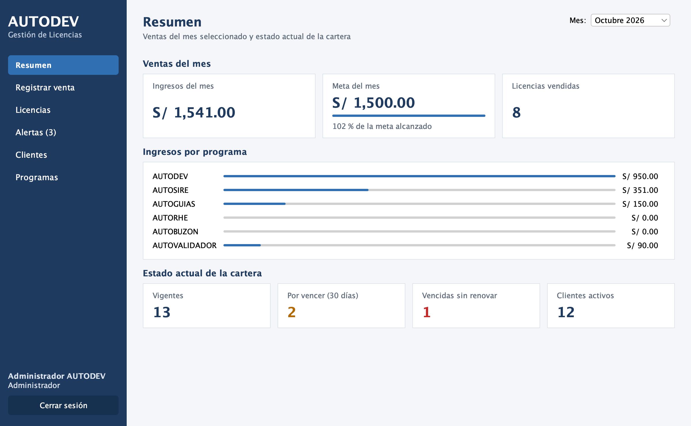

# AUTODEV - Gestión de Licencias

Proyecto del curso **Integrador I: Sistemas - Software** (UTP, 2026-2). Autor: **Anthony Flores**.

Sistema de escritorio en Java para que AUTODEV registre las ventas de licencias de sus programas (AUTODEV, AUTOSIRE, AUTOGUIAS, AUTORHE, AUTOBUZON y AUTOVALIDADOR), calcule su vencimiento y avise antes de que venzan. Reemplaza el Excel compartido que se usaba antes.



## Funcionalidades

| Pantalla | Qué hace |
|---|---|
| Login | Usuario y contraseña cifrada. Tras 3 intentos fallidos se bloquea 30 segundos. |
| Resumen | Ingresos del mes, avance de la meta, ingresos por programa y estado de la cartera. |
| Registrar venta | Venta nueva o renovación. Calcula el total con descuento y el vencimiento (1 año). |
| Licencias | Lista con filtros por texto, estado y programa. Renueva y exporta a Excel. |
| Alertas | Licencias por vencer (30 días) o vencidas. Abre WhatsApp con el mensaje listo. |
| Clientes | Registro y edición con validación de RUC. |
| Programas | Precio de lista de cada programa (solo el administrador lo cambia). |

## Tecnologías y librerías

| Librería | Para qué se usa |
|---|---|
| Java 17 + Swing | Lenguaje y pantallas de escritorio |
| FlatLaf | Apariencia moderna de las pantallas |
| MySQL 8 + Connector/J | Base de datos |
| **Logback** (SLF4J) | Registro de eventos en `logs/autodev-licencias.log` |
| **Apache POI** | Exportar las licencias a Excel (.xlsx) |
| **Apache Commons Lang** | Validar y limpiar textos (`StringUtils`, `NumberUtils`) |
| **Google Guava** | Validaciones (`Preconditions`) y agrupar ventas (`Multimaps`) |
| JUnit 5 | Pruebas unitarias (TDD) |
| Maven | Dependencias, pruebas, Javadoc y `.jar` ejecutable |

## Arquitectura

MVC con una capa de servicios y una capa DAO:

```
Vista (Swing)  ->  Controlador  ->  Servicio (reglas)  ->  DAO (interfaz)  ->  DAO MySQL  ->  MySQL
                                        |
                                     Dominio (Licencia, Cliente, Programa, Alerta, Usuario)
```

- **MVC:** `vista` solo dibuja, `controlador` atiende los eventos y `servicio` + `modelo` tienen las reglas.
- **DAO:** cada tabla tiene una interfaz (`LicenciaDAO`) y su implementación (`LicenciaDAOMySQL`).
- **SOLID:** una responsabilidad por clase, interfaces pequeñas y servicios que dependen de interfaces (los DAO se inyectan por constructor en `Contexto`).
- **TDD:** las pruebas se escribieron antes del código (ver los commits "en rojo" y "verde" del historial).

Diagramas en [`docs/diagramas`](docs/diagramas), procesos BPMN en [`docs/bpmn`](docs/bpmn) y prototipos en [`docs/wireframes`](docs/wireframes).

## Seguridad

- Consultas con `PreparedStatement` (evita inyección SQL).
- Contraseñas guardadas con hash **PBKDF2-HMAC-SHA256** y sal aleatoria; se comparan en tiempo constante.
- Bloqueo de 30 segundos tras 3 intentos fallidos de login.
- Roles: solo el administrador cambia precios.
- Claves de la base de datos en `config.properties`, que **no se sube a GitHub** (`.gitignore`).
- Usuario de MySQL con privilegios mínimos (`SELECT`, `INSERT`, `UPDATE`; sin `DELETE` ni `DROP`).
- Validación de todos los datos de entrada y restricciones `CHECK` en la base de datos.
- Los logs registran eventos (login, ventas, errores) pero nunca contraseñas.

## Cómo ejecutarlo

Requisitos: JDK 17 o superior, Maven 3.9 y MySQL 8.

```bash
# 1. Crear la base de datos y los datos de demostración
mysql -u root -p < sql/01_esquema.sql
mysql -u root -p < sql/03_datos_demo.sql

# 2. Crear el usuario de la aplicación (antes cambiar CAMBIAR por una clave segura)
mysql -u root -p < sql/02_usuario_bd.sql

# 3. Configurar: copiar la plantilla y completar las claves
cp config.example.properties config.properties

# 4. Ejecutar
mvn compile exec:java
```

La primera vez se crean los usuarios `admin` y `vendedor` con las claves iniciales de `config.properties`.

Para generar el `.jar` ejecutable: `mvn package` y luego `java -jar target/autodev-licencias.jar`.

## Pruebas

```bash
mvn test
```

58 pruebas unitarias con JUnit 5. Los servicios se prueban con DAO en memoria (`src/test/.../dao/memoria`), sin necesitar MySQL.

Prueba de integración contra MySQL (venta, alerta, renovación y precio con los DAO reales; deja datos de prueba, usar en la base de desarrollo):

```bash
mvn test -Dtest=FlujoMySQLIT -Dsurefire.failIfNoSpecifiedTests=false
```

## Documentación del código

```bash
mvn javadoc:javadoc
```

La documentación generada está en [`docs/javadoc`](docs/javadoc/index.html).

## Control de versiones

- `main`: versiones entregadas (etiqueta `v0.4-apf3`).
- `develop`: integración.
- `feature/*`: una rama por parte del sistema (modelo, seguridad y DAO, servicios, interfaces, documentación), unida a `develop` con `merge --no-ff`.

## Estructura

```
src/main/java/com/autodev/licencias
├── App.java, Contexto.java   inicio y armado de dependencias
├── config/                   lectura de config.properties
├── modelo/                   entidades y reglas del dominio
├── dao/                      interfaces DAO
│   └── mysql/                implementación con MySQL
├── servicio/                 casos de uso (ventas, alertas, login, reportes, Excel)
├── controlador/              controladores de cada pantalla
├── vista/                    pantallas Swing
└── util/                     cifrado de contraseñas
sql/                          scripts de la base de datos
docs/                         diagramas, BPMN, prototipos, capturas y Javadoc
```
